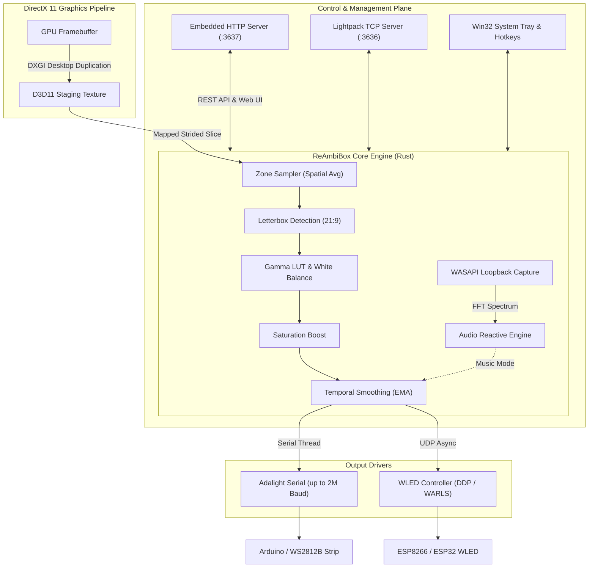

# ReAmbiBox

<div align="center">

[](LICENSE)
[-0078D6.svg?logo=windows)](https://github.com/Deus/ReAmbiBox)
[](https://www.rust-lang.org/)
[]()
[%20%7C%20Network%20WLED%20(DDP%2FWARLS)-9333EA.svg)]()

**Next-generation, ultra-fast ambient backlighting (Ambilight) service for Windows.**  
Built entirely in Rust with DirectX 11 DXGI Desktop Duplication, zero memory allocations per frame, dual USB/Wi-Fi output, and a sleek Web Control Center.

[English](README.md) • [Русский (Russian)](README.ru.md)

</div>

---

## ⚡ Highlights & Key Features

- **🚀 Ultra-Low Latency Zero-Allocation Pipeline**:
  - Captures frames directly from the GPU via DirectX 11 **DXGI Desktop Duplication API**.
  - Sub-millisecond CPU frame sampling with reused scratch buffers and zero heap allocations per tick.
  - Capable of rock-solid 60+ FPS capture with near-zero CPU overhead.
- **🖥️ Multi-Monitor & Ultrawide Ready**:
  - Dynamic display enumeration; instantly switch between any connected monitor.
  - **21:9 Letterbox Detection**: Automatically detects and ignores black cinematic letterbox bars, adapting illumination to movie content in real-time.
- **🎨 Studio-Grade Color Calibration**:
  - **Gamma Correction LUT**: True sRGB 2.2 perceptual curve computed in look-up tables.
  - **White Balance**: Independent RGB channel gains for room wall color matching.
  - **Black Level Threshold**: Automatically shuts off LEDs during dark scenes (0–50), preventing ambient wash-out in horror films and dark games.
  - **Saturation Boost**: Enhances washed-out monitor colors for vivid, punchy wall diffusion.
  - **LED Color Order**: Reconfigurable color mapping (`RGB` / `GRB` / etc.) to match WS2812B / WS2811 / SK6812 strips.
- **🌊 Adaptive Temporal Smoothing**:
  - Exponential Moving Average (EMA) smoothing filter to eliminate jitter without sluggish lag.
- **🎵 WASAPI Audio Reactive (Light-Music)**:
  - High-precision loopback audio capture via Windows WASAPI.
  - Real-time FFT analysis with 3 built-in music modes: **Beat Pulse**, **VU Spectrum**, and **Color Wave**.
- **🔌 Dual Output Architecture**:
  - **USB Serial (Adalight / AmbiBox / Arduino)**: High-speed baud rates up to 2,000,000 baud with auto-reconnect on unplug and safe DTR bootloader pacing.
  - **Network WLED (Wi-Fi UDP)**: Direct zero-copy network streaming using **DDP** (Distributed Display Protocol) and **WARLS** with automatic packet chunking for large LED counts.
- **🎛️ Modern Web Control Center (`http://localhost:3637`)**:
  - **Perimeter Zone Wizard**: Generate uniform perimeter layouts in seconds (including built-in 98-zone AmbiBox template).
  - **Interactive Zone Canvas**: Drag-and-drop zone positioning, edge resize handles, and boundary snapping.
  - **Lighting Presets**: Create, switch, overwrite, and rename custom lighting presets.
  - **Instant Bilingual UI**: Switch between English and Russian without reloading.
- **⌨️ System-Wide Global Hotkeys**:
  - Global Windows hotkeys for power toggle, brightness adjustments (±10%), and zone calibration overlay.
- **💡 Lightpack API Compatibility**:
  - Built-in TCP server on port `3636` compatible with Kodi, Prismatik, Home Assistant, and legacy AmbiBox Python scripts.
- **🪟 Native Windows Desktop Integration**:
  - Native system tray context menu with quick controls.
  - Workstation lock (`Win + L`) and display sleep (`GUID_MONITOR_POWER_ON`) detection with automatic LED power-saving blanking.
  - Single-instance takeover ensuring seamless updates without COM-port contention.
  - Single standalone executable with all UI assets, icon, and translation dictionaries embedded directly into the PE binary.

---

## 🏗️ Architecture



---

## 🚀 Quick Start

### 1. Download
Grab the latest release from the [Releases](https://github.com/Deus/ReAmbiBox/releases) page:
- **Portable Version**: `ReAmbiBox-Portable-v0.1.0.zip` (unpack anywhere and run `reambibox.exe`).
- **Installer**: `ReAmbiBox-Setup-v0.1.0.exe` (optional setup with autostart and shortcut options).

### 2. Launch
1. Run `reambibox.exe`. The app minimizes into your Windows Notification Area (System Tray near the clock).
2. Open your web browser and navigate to:
   ```
   http://localhost:3637
   ```
3. In the **Hardware** tab, choose your output:
   - **USB Serial Port**: Select your Arduino COM-port and Baud Rate (typically `115200` or `500000`).
   - **Network WLED**: Enter your WLED controller's IP address (protocol: `DDP` recommended).
4. In the **Zone Editor** tab:
   - Click **Perimeter Zone Wizard...**, enter the number of LEDs along your monitor borders, choose starting corner and direction, and click **Apply to Screen**.
5. Adjust brightness, gamma, and color calibration in the **Dashboard**.

---

## ⌨️ Global Hotkeys

ReAmbiBox registers system-wide Windows hotkeys for effortless control during full-screen games and movies:

| Action | Default Hotkey | Description |
|---|---|---|
| **Toggle Power** | `Ctrl + Shift + A` | Turns illumination On / Off instantly |
| **Brightness Up** | `Ctrl + Shift + Up` | Increases brightness by +10% |
| **Brightness Down** | `Ctrl + Shift + Down` | Decreases brightness by -10% |
| **Toggle Zone Overlay** | `Ctrl + Shift + O` | Displays calibration rectangles directly over your screen |
| **Close Overlay** | `Esc` | Hides and saves zone positions |

*Hotkeys can be customized or disabled individually in the **Hardware** tab.*

---

## 📡 Lightpack Compatibility API

ReAmbiBox includes a built-in TCP server on port `3636` implementing the standard Lightpack protocol. This allows third-party tools to control ReAmbiBox seamlessly:

```bash
# Example telnet / socket interaction
telnet 127.0.0.1 3636
> getstatus
< status:on
> setcolor:1-255,255,255
< ok
```

Supported integrations:
- **Kodi**: Official Lightpack / Boblight plugins
- **Home Assistant**: Prismatik / Lightpack integrations
- **AmbiBox scripts**: Legacy Python and automation scripts

---

## 🛠️ Building from Source

### Prerequisites
- **Operating System**: Windows 10 or 11 (64-bit)
- **Rust Toolchain**: Stable 1.75+ (`x86_64-pc-windows-msvc`)
- **Git**
- Optional: **Inno Setup 6** (only required to compile the `.exe` installer)

### Build Steps

```powershell
# 1. Clone the repository
git clone https://github.com/Deus/ReAmbiBox.git
cd ReAmbiBox

# 2. Run unit tests
cargo test --workspace

# 3. Build optimized release binary
cargo build --release --bin reambibox

# 4. Package distribution zip & installer (PowerShell)
.\scripts\package.ps1
```

The compiled binaries and portable archive will be located in `target/dist/`:
- `target/dist/ReAmbiBox-Portable-v0.1.0.zip`
- `target/dist/reambibox.exe`

---

## 💡 Supported LED Hardware & Firmware

- **Microcontrollers**: Arduino Nano, Uno, Pro Micro, Leonardo, ESP8266, ESP32, Raspberry Pi Pico.
- **Firmware**:
  - **Adalight** (FastLED / NeoPixel based sketches for Arduino).
  - **WLED** (0.13+ recommended; supports high-speed UDP DDP / WARLS).
  - **AmbiBox** compatible Arduino sketches.
- **Addressable LED Strips**: WS2812B, WS2811, SK6812, APA102.

---

## 📄 License

This project is licensed under the **MIT License** — see the [LICENSE](LICENSE) file for details.

Copyright (c) 2026 Vladislav Ermolaev
