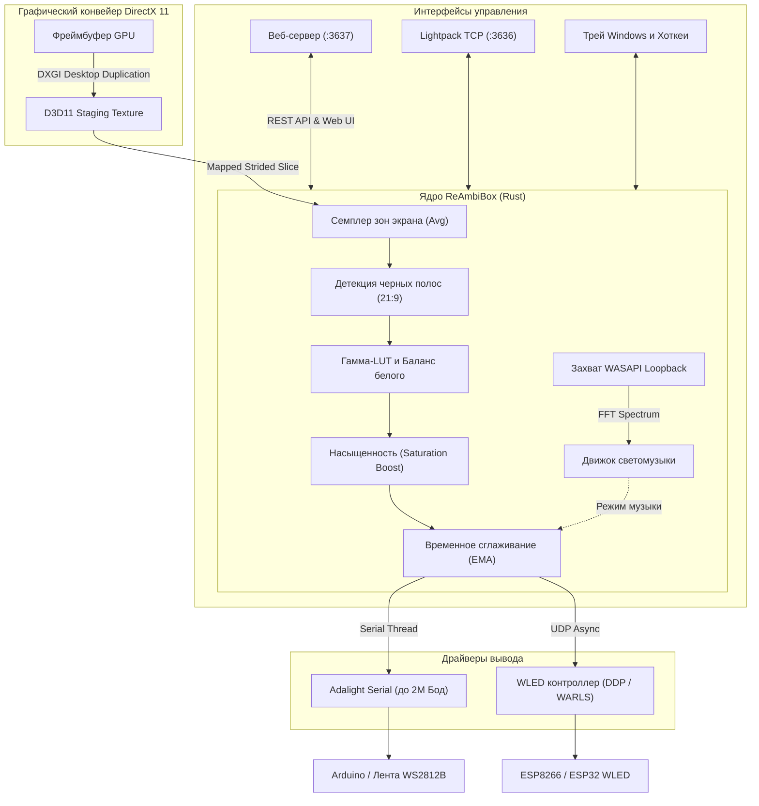

# ReAmbiBox

<div align="center">

[](LICENSE)
[-0078D6.svg?logo=windows)](https://github.com/Deus/ReAmbiBox)
[](https://www.rust-lang.org/)
[]()
[%20%7C%20Network%20WLED%20(DDP%2FWARLS)-9333EA.svg)]()

**Современный высокопроизводительный сервис фоновой подсветки (Ambilight) для Windows.**  
Разработан полностью на языке Rust с прямым захватом экрана через DirectX 11 DXGI Desktop Duplication, нулевыми аллокациями памяти на кадр, поддержкой USB/Wi-Fi вывода и отзывчивым веб-интерфейсом управления.

[English](README.md) • [Русский](README.ru.md)

</div>

---

## ⚡ Ключевые возможности и особенности

- **🚀 Конвейер захвата с ультранизкой задержкой (Zero-Allocation)**:
  - Прямой захват кадров из памяти видеокарты через **DirectX 11 DXGI Desktop Duplication API**.
  - Пространственное усреднение цветов зон экрана за доли миллисекунды без динамических аллокаций памяти (`0 heap allocations per tick`).
  - Стабильные 60+ FPS захвата при околонулевой нагрузке на центральный процессор (~0% CPU).
- **🖥️ Поддержка нескольких мониторов и ультрашироких экранов**:
  - Динамическое перечисление и мгновенное переключение между любыми подключенными мониторами.
  - **Детекция черных полос (21:9 Letterbox)**: Автоматическое определение кинематографических черных полос сверху и снизу с интеллектуальной адаптацией зон захвата к реальному изображению фильма.
- **🎨 Профессиональная калибровка цвета под интерьер**:
  - **Гамма-коррекция (LUT)**: Точная нелинейная кривая sRGB 2.2 через предварительно рассчитанные таблицы поиска.
  - **Баланс белого**: Независимая регулировка усиления каналов R, G, B для компенсации цвета стен за монитором.
  - **Отсечка чёрного уровня (Black Level Threshold)**: Гасит светодиоды в темных сценах (0–50), предотвращая паразитную засветку в хоррорах и ночных кинолентах.
  - **Усиление насыщенности (Saturation Boost)**: Добавляет сочности блеклым оттенкам монитора при рассеивании на стене.
  - **Порядок цветов светодиодов**: Поддержка WS2812B, WS2811, SK6812 с переключением `RGB` / `GRB`.
- **🌊 Адаптивное временное сглаживание**:
  - Сглаживание экспоненциальным скользящим средним (EMA) для устранения резких скачков и мерцания при сохранении динамичности сцен.
- **🎵 Светомузыка WASAPI Audio Reactive**:
  - Захват системного звука Windows в режиме Loopback (не требуются сторонние виртуальные аудиокабели).
  - Быстрое преобразование Фурье (FFT) с 3 режимами визуализации: **Beat Pulse (Пульсация под бит)**, **VU Spectrum (Эквалайзер)** и **Color Wave (Бегущая волна)**.
- **🔌 Архитектура двойного вывода**:
  - **USB Serial (Adalight / AmbiBox / Arduino)**: Поддержка высоких скоростей передачи данных (до 2 000 000 бод), автовосстановление соединения при отключении кабеля и защита от перезагрузки загрузчика Arduino по линии DTR.
  - **Сетевой контроллер WLED (Wi-Fi UDP)**: Прямая передача пакетов по протоколам **DDP** (Distributed Display Protocol) и **WARLS** с автоматической фрагментацией на чанки для большого количества светодиодов.
- **🎛️ Веб-панель управления (`http://localhost:3637`)**:
  - **Мастер периметра экрана**: Быстрая автоматическая расстановка светодиодов по периметру за пару кликов (включая готовый шаблон AmbiBox на 98 зон).
  - **Интерактивный редактор зон**: Перетаскивание мышью (Drag & Drop), изменение размеров за угол и умная магнитная привязка к краям экрана.
  - **Менеджер пресетов**: Сохранение, мгновенное переключение, перезапись и переименование настроек (для кино, игр, вечернего чтения и т.д.).
  - **Двуязычный интерфейс**: Мгновенное переключение между русским и английским языками без перезагрузки страниц.
- **⌨️ Глобальные горячие клавиши Windows**:
  - Управление подсветкой поверх полноэкранных игр и фильмов (включение/выключение, шаг яркости ±10%, экранный оверлей зон).
- **💡 Совместимость с протоколом Lightpack API**:
  - Встроенный TCP-сервер на порту `3636`, совместимый с плагинами Kodi, Prismatik, интеграциями Home Assistant и скриптами AmbiBox.
- **🪟 Интеграция с рабочим столом Windows**:
  - Удобное контекстное меню в системном трее возле часов.
  - Отслеживание выключения монитора и блокировки сессии (`Win + L`) с автоматическим переходом светодиодов в энергосберегающий режим (гашение).
  - Защита от дублирования процессов (Single-Instance Takeover): повторный запуск плавно замещает старый экземпляр, не блокируя занятый COM-порт.
  - Один компактный исполняемый `.exe` со вшитой иконкой, веб-интерфейсом и словарями перевода.

---

## 🏗️ Архитектура системы



---

## 🚀 Быстрый старт

### 1. Скачивание
Загрузите свежую сборку на странице [Релизов](https://github.com/Deus/ReAmbiBox/releases):
- **Портативная версия**: `ReAmbiBox-Portable-v0.1.0.zip` (распакуйте в любую удобную папку и запустите `reambibox.exe`).
- **Инсталлятор**: `ReAmbiBox-Setup-v0.1.0.exe` (удобная установка с ярлыками и автозагрузкой).

### 2. Запуск и настройка
1. Запустите файл `reambibox.exe`. Программа свернется в системный трей возле часов.
2. Откройте панель управления в любом веб-браузере:
   ```
   http://localhost:3637
   ```
3. Во вкладке **Оборудование**:
   - Для **USB COM-порта**: выберите порт вашей платы Arduino и скорость соединения (обычно `115200` или `500000`).
   - Для **WLED**: введите IP-адрес контроллера в локальной сети (рекомендуется протокол `DDP`).
4. Во вкладке **Редактор зон**:
   - Нажмите **Мастер периметра экрана...**, укажите количество светодиодов по сторонам монитора, начальный угол и направление обхода, затем нажмите **Применить к экрану**.
5. Отрегулируйте желаемую яркость, сглаживание и баланс белого на главной вкладке.

---

## ⌨️ Глобальные горячие клавиши Windows

ReAmbiBox поддерживает глобальные сочетания клавиш для комфортного управления прямо во время игр и фильмов:

| Действие | Сочетание по умолчанию | Описание |
|---|---|---|
| **Вкл/Выкл подсветки** | `Ctrl + Shift + A` | Мгновенно включает или тушит подсветку |
| **Яркость выше** | `Ctrl + Shift + Вверх` | Увеличивает яркость на +10% |
| **Яркость ниже** | `Ctrl + Shift + Вниз` | Уменьшает яркость на -10% |
| **Оверлей зон** | `Ctrl + Shift + O` | Показывает на экране рамки захвата зон |
| **Закрыть оверлей** | `Esc` | Скрывает экранный оверлей и сохраняет координаты |

*Горячие клавиши можно переназначить или отключить во вкладке **Оборудование**.*

---

## 📡 Lightpack API

Встроенный TCP-сервер на порту `3636` поддерживает стандартный открытый протокол Lightpack:

```bash
# Пример взаимодействия через telnet / socket
telnet 127.0.0.1 3636
> getstatus
< status:on
> setcolor:1-255,255,255
< ok
```

Поддерживается интеграция с:
- **Kodi**: Официальные аддоны Lightpack / Boblight
- **Home Assistant**: Компоненты Prismatik / Lightpack
- Скриптами автоматизации на Python, ранее написанными под AmbiBox

---

## 🛠️ Сборка из исходников

### Требования
- **ОС**: Windows 10 или 11 (64-бит)
- **Компилятор Rust**: Версия Stable 1.75+ (`x86_64-pc-windows-msvc`)
- **Git**
- Опционально: **Inno Setup 6** (только для сборки инсталлятора `ReAmbiBox-Setup-v*.exe`)

### Инструкция по сборке

```powershell
# 1. Клонирование репозитория
git clone https://github.com/Deus/ReAmbiBox.git
cd ReAmbiBox

# 2. Прогон модульных тестов
cargo test --workspace

# 3. Сборка оптимизированного релизного бинарника
cargo build --release --bin reambibox

# 4. Упаковка дистрибутива и инсталлятора через PowerShell
.\scripts\package.ps1
```

Готовые файлы будут созданы в папке `target/dist/`:
- `target/dist/ReAmbiBox-Portable-v0.1.0.zip`
- `target/dist/reambibox.exe`

---

## 💡 Поддерживаемое оборудование

- **Контроллеры**: Arduino Nano, Uno, Pro Micro, Leonardo, ESP8266, ESP32, Raspberry Pi Pico.
- **Прошивки**:
  - **Adalight** (прошивки на библиотеках FastLED / Adafruit NeoPixel).
  - **WLED** (версии 0.13+; поддержка высокоскоростных протоколов UDP DDP / WARLS).
  - Стандартные скетчи Arduino для AmbiBox.
- **Светодиодные ленты**: WS2812B, WS2811, SK6812, APA102.

---

## 📄 Лицензия

Проект распространяется под открытой лицензией **MIT** — подробности в файле [LICENSE](LICENSE).

Copyright (c) 2026 Vladislav Ermolaev
